# Mass-Conserving Eulerian Liquid Simulation — WebGL2

A browser implementation of

> N. Chentanez, M. Müller. *Mass-Conserving Eulerian Liquid Simulation.*
> ACM SIGGRAPH / Eurographics Symposium on Computer Animation, 2012.

in 2D and 3D. The whole solver runs on the GPU as WebGL2 shader passes over float textures
(about 190–215 passes per time step). JavaScript only sequences the passes, integrates the
few rigid bodies and sums a small reduced texture for the on-screen statistics.

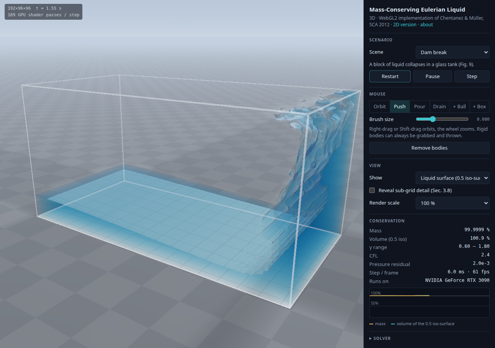

## Screenshots

3D (`3d.html`): the liquid surface is ray-marched from the density field.

| | | |
|:-:|:-:|:-:|
| 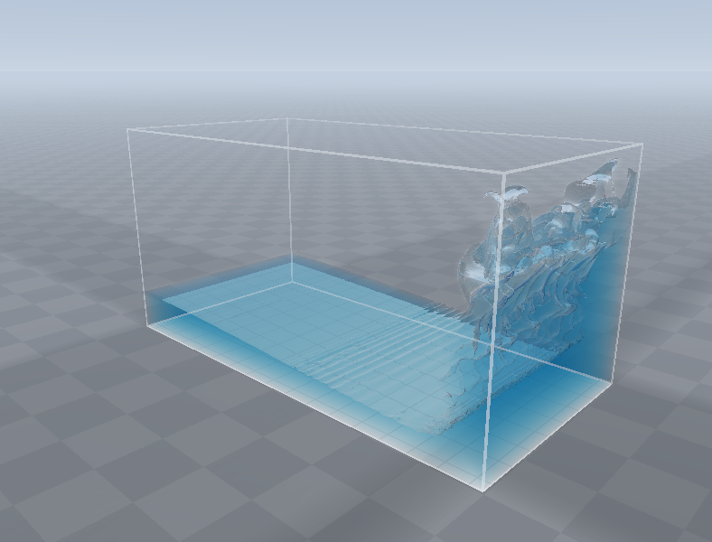 | 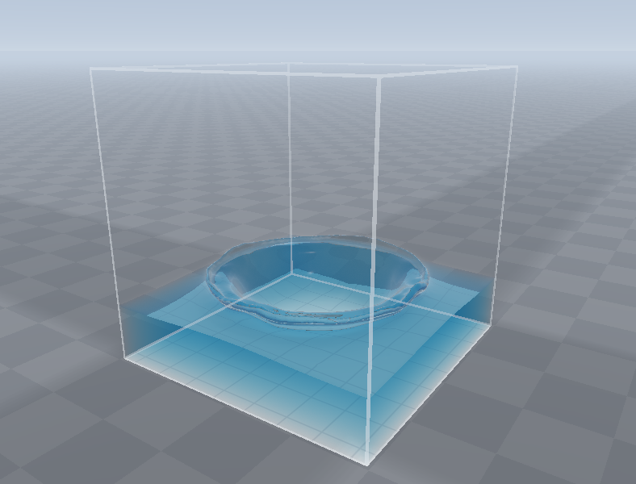 | 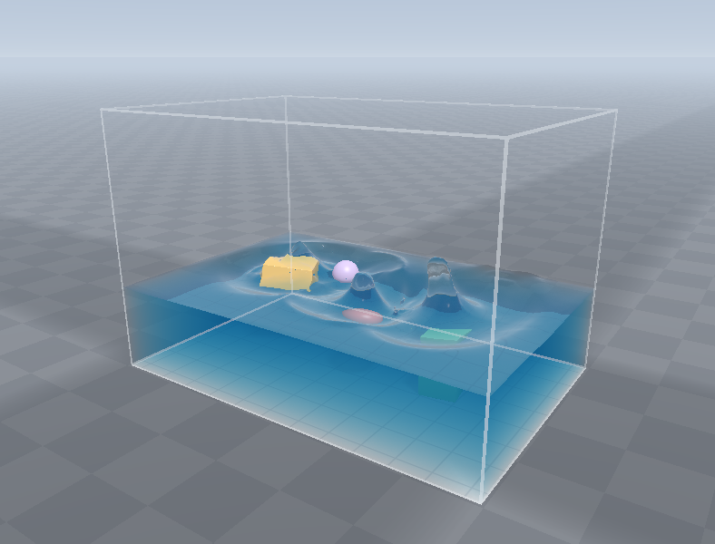 |
| Dam break, 256×128×128, t = 1.5 s | Ball dropped into a pool, 96³, t = 0.5 s | Rigid bodies of different densities, 144×96×96 |
| 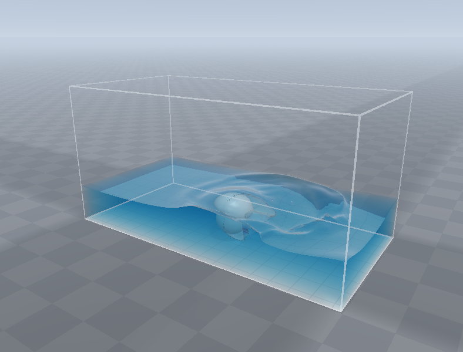 | 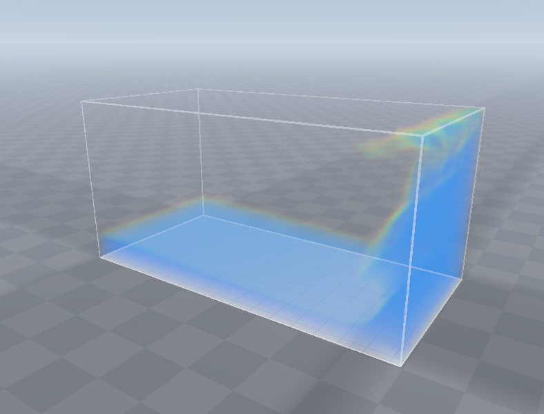 | |
| Fast moving obstacle, 192×96×96 | The density field itself (volume view), dam break | |

2D (`2d.html`), 256² grids:

| | | | |
|:-:|:-:|:-:|:-:|
| 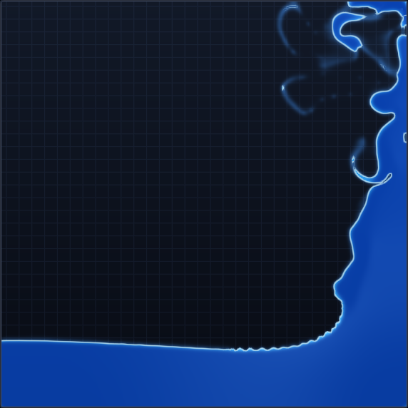 | 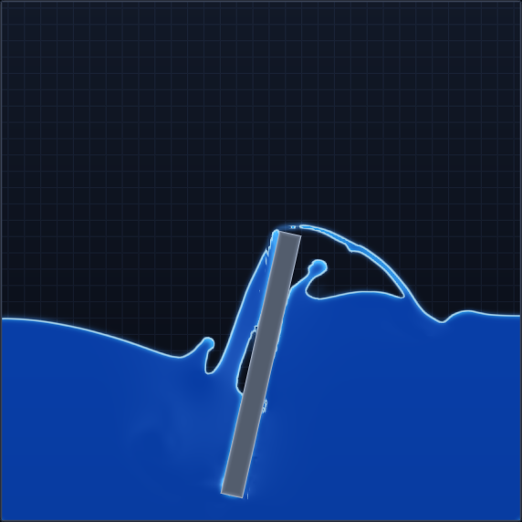 | 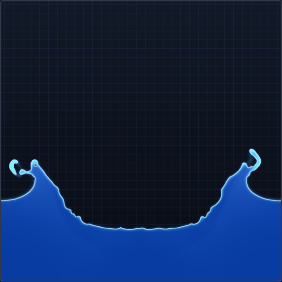 | 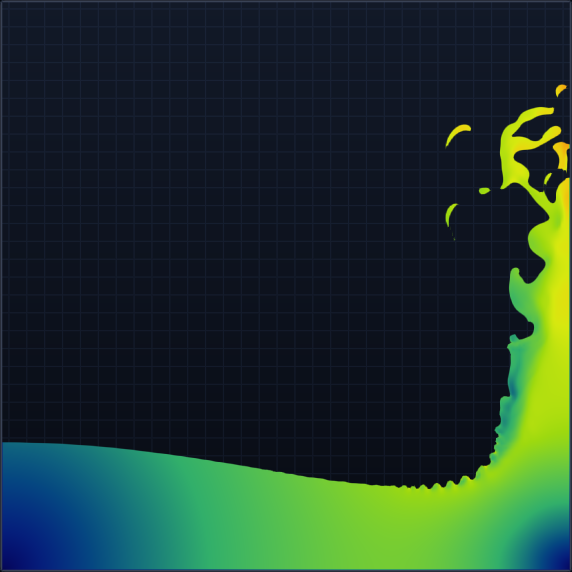 |
| Dam break | Rotating paddle | Ball into pool | Dam break, speed view |

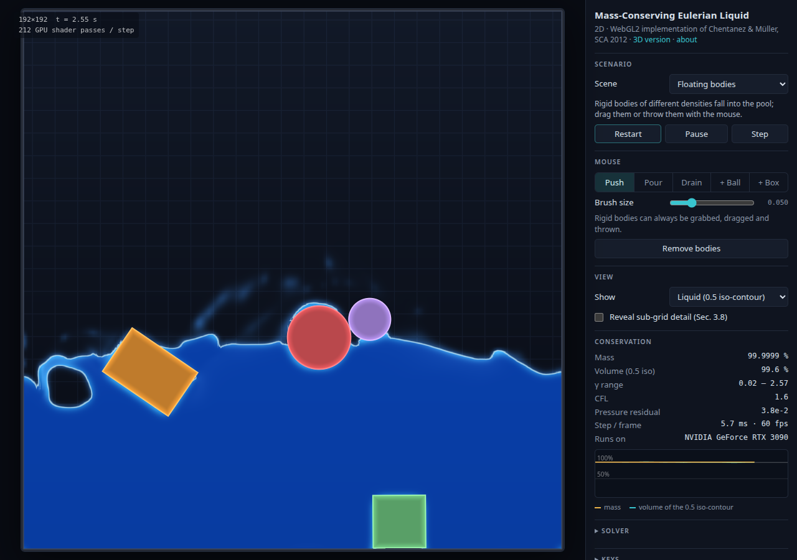

The pictures are produced from the real apps by `node tools/screenshots.mjs`.

## Run

```sh
node tools/serve.mjs          # or: python3 -m http.server 8080
# open http://localhost:8080/   (2d.html, 3d.html)
```

ES modules do not load from `file://`, so the folder has to be served. Requirements: WebGL2
with `EXT_color_buffer_float`, `EXT_float_blend`, `OES_texture_float_linear`.

Tested in Chrome 154, Firefox 159 and LibreWolf 156 (Linux, NVIDIA). Two things differ in the
Firefox family:

* Firefox refuses a draw call with more than 30 million vertices
  (`webgl.max-vert-ids-per-draw`) and only says so in the console. The scatter passes of the
  256×128×128 grid have 33.5 million points, so they are drawn in pieces of 2²⁴
  (`GLContext.scatter`); before that the conservative advection silently did nothing at that
  resolution and the liquid lost mass and blew up within a second. The first step on every
  new grid now also checks `gl.getError()` and stops with a message if a pass was refused.
* With `privacy.resistFingerprinting` on (the default in LibreWolf) every read-back from the
  GPU returns random numbers. The apps test this at start-up and say so: the liquid still
  runs, but the statistics, the liquid's force on rigid bodies and 3D picking are switched
  off. With that setting off LibreWolf still flips the last bits of some values that are read
  back, which is harmless here.

WebGL2 was chosen over WebGPU because WebGPU has no adapter in stock Chrome 154 on
Linux/NVIDIA (it needs three launch flags), while WebGL2 is hardware accelerated out of the box.

## What is implemented

| Paper | Where |
|---|---|
| Sec. 3.1 staggered grid | `src/shaders/common.js` (layout, sampling, characteristic tracing) |
| Sec. 3.3 velocity extrapolation | `extrapInit / extrapPull / extrapPush` in `src/shaders/sim.js` |
| Sec. 3.4 conservative advection (modified scheme, steps 1–8) | `advTrace`, `scatterBeta`, `advGather`, `scatterFwd`, `diffuse` |
| Sec. 3.5 sharpening, Eq. 4–17, Algorithm 2 | `sharpen`, `scatterSharp` |
| Sec. 3.6 solids, Eq. 18–19, excess density | `solid`, `sharpen` |
| Sec. 3.7 incompressibility, Eq. 20, ρ′ > 1 divergence | `liq`, `coef`, `rhs`, `smooth`, `restrict`, `prolong`, `project` |
| Sec. 3.8 density post-processing | `src/render2d.js`, `src/render3d.js` |
| Multigrid with separating solid boundaries [CM11a] | `smooth` (projected red–black Gauss–Seidel), `restrict` (DownsampleSubtract) |

One code path serves both dimensions: the grid is stored as a 2D atlas of z-slices and the 2D
simulator is the `nz = 1` case (`#define DIM` strips the z work).

The scatter steps of the advection and sharpening (the part the paper calls expensive on GPUs)
are drawn as `GL_POINTS`, one point per (cell, stencil corner), with additive blending into
32-bit float targets.

Scenes: dam break, splat, ball into pool / crown splash, double dam, jet, filling a dry tank,
dam break over a step, fast moving obstacle, rotating paddle, round and spherical containers,
shaken container, floating rigid bodies, still pool. Mouse: push, pour, drain, spawn / grab /
throw rigid bodies; orbit and zoom in 3D.

## Measured

Chrome 154, RTX 3090, default settings unless stated.

| Grid | Step time | Paper, Table 2 (GTX 680) |
|---|---|---|
| 128² (2D) | ≈ 1.4 ms | – |
| 128 × 64 × 64 | 3.2 ms | 26.7 ms (for 128 × 128 × 64) |
| 128³ | 8.8 ms | 53.4–54.2 ms |
| 256 × 128 × 128 | 18.0 ms | 113.2–118.6 ms |

* Mass: drifts by at most 5e-6 relative over 10 s in every 2D scene, at Δt = 1/60 s and at
  Δt = 1/30 s with CFL up to 21, and by 1e-6 to 3e-6 over 240 steps in 3D. The drift is 32-bit
  float round-off (tiny deposits added to cells holding ρ ≈ 1) and keeps accumulating: 4e-5
  after 60 s of the floating bodies scene. The paper's own Fig. 10 shows ±0.05 %.
* Row sums γ for the ball drop at 128², Δt = 1/60 s, over cells holding liquid: 0.77–2.62 over
  the whole run, 0.91–1.09 once the pool has settled. The paper's Table 1 reports 0.627–2.403
  for its run of this test.
* A pool at rest stays at rest: after 120 s at 64², 128² and 256² the liquid speed is
  0.0000 m/s, the surface height has not changed in the second decimal of a cell and the bulk
  density is 1.000 ± 0.000. (At 384² see the limitations.)
* Plain semi-Lagrangian advection on the same dam break: 10 % of the mass left after 10 s.
* Volume of the 0.5 iso-contour stays within roughly 95–107 % once splashes settle, with dips
  while liquid is spread thinner than a cell (as in the paper's Fig. 10).
* Floating bodies in contact (`tests/contact2d.html`, six arrangements from two touching balls
  to five bodies dropped on top of each other, three slightly different pool depths each,
  128²): between 90 s and 120 s the fastest body moves at 0.05–0.13 m/s (0.02–0.04 cells per
  step), depending on the arrangement. Runs that differ only in the pool depth differ by up
  to a factor of five in the bodies' kinetic energy, so single runs say little.

Reproduce with the pages in `tests/` through `node tools/run.mjs <page>` (`still2d.html` runs
any 2D scene for a long time and reports rest, residuals and rigid body motion, `body2d.html`
drops one body into a pool, `contact2d.html` floats bodies that touch each other and reports
whether they settle, `glinfo.html` prints the browser's WebGL2 limits and whether
float read-back is exact) and with `node tools/interact.mjs 2d|3d`, which drives the real
apps with synthetic mouse input. Both tools take `--browser chrome|firefox|librewolf`;
`npm test` runs the interaction checks in Chrome, `npm run test:firefox` and
`npm run test:librewolf` in the other two.

## Where the paper leaves a choice open

These are interpretations, not things the paper states. Each was decided by experiment.

1. **γ is the per-step row sum of the advection operator**, not an advected cumulative field.
   The text supports this ("γᵢ = Σⱼ Aᵢⱼ", "can be done in-place"); the formula in step 7 has an
   extra γⱼ factor that I dropped. An advected cumulative γ fights the intentional divergence of
   Sec. 3.7 and was unstable. The row scale γᵢ / max(1, βₗ) is used as printed; the solver menu
   also offers 1/γ and no feedback.
2. **γ diffusion (advection step 8) exchanges pairwise, between liquid cells only, and never
   uphill.** As [LAF11] describes it, two neighbours meet at the mean of their γ: one pass per
   axis and pair parity, (2k, 2k+1) then (2k+1, 2k+2). Exchanging with both neighbours at once
   (a Jacobi sweep with the same coefficient) flips a cell-to-cell alternation instead of
   damping it; a pool at rest then slowly grew a density checkerboard and its surface started
   to move up and down at grid frequency. Outside the liquid the velocity is an extrapolation
   that is not divergence free, so row sums there are not a compression signal; exchanging with
   them smeared the surface. And an exchange may level ρ′ between two cells but never moves
   liquid from the emptier into the fuller one, which would work against the intentional
   divergence of Sec. 3.7.
3. **Solids in the advection.** Capacities are the non-solid volume fractions V, so the scheme
   transports ρ′ = ρ/V and γᵢ = (Σ Aᵢₗ Vₗ)/Vᵢ. Without this, wall cells inflated γ and still
   water next to a wall was unstable.
4. **Artificial divergence** for ρ′ > 1 is min(λ(ρ′−1), η)/Δt. The paper prints Δx in the
   denominator, which is not a divergence dimensionally.
5. **Sharpening near solids** uses ρ′ (extrapolated into solid cells) for the weight, the
   limiter and the gradient trace, and ρ with face area fractions for Eq. 18–19 as printed.
6. **Coarse multigrid levels** average the interface position φ = 0.5 − ρ′ of their children
   (weighted with the non-solid volume, and clamped at −0.5 so that over-full cells do not
   dominate). Averaging erases air pockets smaller than a coarse cell together with their
   p = 0 condition, which made the V-cycle diverge as soon as a splash trapped air. Every
   coarse cell therefore carries a diagonal "leak" term: the ghost-fluid coupling of its
   children to the air that the coarse level no longer sees. Measured convergence per V-cycle:
   0.05–0.1 on a pool at rest, about 0.3 in the round tank. Keeping every coarse cell that
   covers both liquid and air as air (what this code did first) was stable but only reached
   0.76–0.87; the unconverged remainder showed as a pulsing flow with air pockets in the
   corners of a pool at rest. The reference's "average of positive φ" rule was not monotone.
7. **Solid fractions** are computed from analytic distance fields: volume fractions as
   clamp(0.5 + d), area fractions as a planar cut. A wider ramp leaked pressure through wall
   corners. Faces between two cells that are both almost entirely solid (V < 0.1) are closed:
   such a sliver, for instance under a body lying on the floor, has no neighbour with real
   volume to take its liquid/air state from and otherwise acts as an air pocket at the bottom
   of the pool that the liquid next to it rushes into.
8. **Velocity advection** is semi-Lagrangian with a midpoint trace (the paper does not say).
9. **Velocity extrapolation** uses the grid hierarchy only; the reference additionally runs an
   eikonal solver in a two-cell band.

## Additions beyond the paper

* **Volume correction (on by default, switchable under *Solver*).** The paper's sharpening
  never touches ρ > 0.5 and it notes that the 0.5 iso-contour could in theory swell to twice
  the true volume, "which does not happen in practice". Here it did happen: numerically diluted
  liquid (ρ′ between 0.5 and 1) is incompressible and stays diluted, and the ball-drop pool grew
  to 138–148 % volume in 15 s. Interior liquid cells holding less than their volume are
  therefore contracted with a negative artificial divergence, the mirror image of the paper's
  ρ′ > 1 term. With it the same run stays at 96–101 %. Switch it off to see the method exactly
  as published.
* **Two-way rigid bodies.** The paper couples solids to the liquid one way; bodies here also
  feel the liquid. The next section describes how.
* **Rendering.** The surface is ray-marched instead of meshed with marching cubes.

## Rigid bodies

No physics library is used. The rigid bodies are a small solver in `src/bodies.js` that runs
in JavaScript on the CPU (a scene holds at most 12 solids, container included); everything
that touches grid cells stays in shaders.

**State and shapes.** A body is a ball or a (rounded) box with a position, an orientation
quaternion, a linear and an angular velocity, and a density relative to the liquid. Shapes are
analytic signed distance functions, the same primitives the liquid solver rasterises. A 2D
body is the same object restricted to the plane (rotation about z only). Scripted obstacles
(paddle, moving sphere) and the container are bodies of infinite mass whose velocity is the
finite difference of their scripted position.

**One time step** (`Runner.step`):

1. Scripted obstacles and the container move to their position at t + Δt.
2. `stepBodies` advances the dynamic bodies, using the liquid force measured after the
   previous liquid step: velocities first, then positions (semi-implicit Euler; the
   orientation is rotated by ω Δt), then contacts.
3. The liquid step runs with the bodies at their new positions and velocities.
4. The pressure of that step is integrated over every body on the GPU and read back for the
   next step.

**Body → liquid** is the paper's solid coupling (Sec. 3.6, 3.7). The `solid` pass turns all
primitives into a solid distance, a solid velocity v + ω × r per face, face area fractions and
cell volume fractions. The pressure solve takes the solid velocity as its boundary condition
(variational discretisation, separating boundaries), so a moving body pushes liquid aside and
drags it along, and density that ends up inside a solid is pushed out.

**Liquid → body** is not in the paper. The `bodyForce` pass draws one point per cell; cells
within 1.5 cells of a body's surface evaluate −p ∇W, where W is that body's own non-solid
volume fraction, so ∇W is the discrete surface normal times area of the pressure
discretisation. Force, torque r × f, the wet fraction of the surface and the mean liquid
velocity next to the body are summed by additive blending into one texel per body and read
back through a pixel-pack buffer and a fence, without stalling the GPU. Buoyancy is not a
separate formula: it is what the hydrostatic part of the pressure integrates to.

The force arrives one step late: what is measured after a step is the liquid's answer to the
acceleration A the body had in that step, f = s − m A, where s is the force on a body that
does not accelerate (buoyancy, waves) and m its added mass, the liquid it has to accelerate
with it, in units of its own mass. Applying f as measured treats the added mass explicitly,
which diverges as soon as m > 1: a light body, a body next to a wall or to another body,
bodies that cover the surface. It is therefore conditioned before use:

* **Added mass, identified while running.** s is recovered as f + r A and the equation of
  motion (1 + r) a = g + s is solved for the new acceleration. With r = m this is exact; an r
  that is too large delays the liquid's answer and feeds a bobbing body, one that is too
  small overshoots. m depends on the direction and on everything around the body, so r is
  estimated per axis (and once for the rotation) by recursive least squares from the second
  differences of f and A over the last three steps (s changes smoothly from step to step,
  m A does not), forgetting 2 % per step (0.5 % next to another solid), starting from
  0.5 · max(wet, 0.3) / density. A is the acceleration the body really had, contacts and
  drag included.
* **No smoothing.** A low-pass filter on the force delays the restoring force, and a delayed
  restoring force adds energy to every oscillation.
* **Four V-cycles** instead of two while a body that feels the liquid is wet. What an
  unconverged pressure solve leaves out of the liquid's answer arrives one step later, and
  bodies wedged against each other, where the multigrid converges slowest, turn that delay
  into a hopping motion with a period of four steps.
* a cap at 3 g / min(density, 1), with the torque scaled by the same factor, so that a late
  impact spike cannot catapult a light body;
* next to another solid (within 1.5 cells) the liquid may stop a body's approach and carry
  its weight, but not push it away harder than that: the stiff force of a squeezed film
  arrives after the contact has already stopped the body and would otherwise throw it back;
* quadratic and linear drag relative to the surrounding liquid and damping of the spin
  (both unconditionally stable), because the inviscid solver exerts no shear on a body.

**Contacts** are found by testing sample points on each body's surface (16 in 2D, 26 in 3D:
for a box its corners, edge midpoints and face centres) against the distance functions of
the container, the scripted obstacles and the other bodies. The deepest point is pushed out along the normal
(80 % per step, shared by inverse mass). Velocities are corrected with sequential impulses
(projected Gauss–Seidel, 10 iterations): one non-penetration constraint per touching point
with an accumulated, non-negative normal impulse, and Coulomb friction (μ = 0.4) limited by
it. A contact only bounces (restitution 0.25) if the approach speed before this step's
forces exceeds 8 cells/s, so a body lying on the floor ends the step exactly at rest; any
residual velocity would be seen by the liquid as a moving wall and pump it.

**Mouse.** A grabbed body is driven towards the pointer with a limited velocity and still
takes part in contacts, so it cannot be pulled through a wall; on release it keeps its
velocity and can be thrown.

This is a partitioned, explicit coupling, not a strongly coupled solve with the bodies inside
the pressure system as in [BBB07]; the consequences are listed under the limitations below.
Because contacts use surface sample points, two boxes meeting edge to edge between sample
points can interpenetrate slightly before the contact is seen.

## Known limitations

* Verified on Linux with an NVIDIA GPU only (Chrome 154, Firefox 159, LibreWolf 156). Firefox
  has no GPU timer queries for WebGL2, so the step time read-out stays empty there.
* Density below 0.5 ("mist") has no dynamics of its own: as in the paper it moves with velocity
  extrapolated from the nearest liquid, so spray can hang in the air until sharpening gathers it.
* Two V-cycles per step (four while rigid bodies are in the liquid) leave a pressure residual
  around 1e-2 during violent motion; raise *V-cycles / step* for a tighter solve.
* At 384² a pool at rest starts a slow long slosh after about a minute (±1.4 cells of 153
  after 120 s). The pressure residual sits at 1.6e-3 from the first step there and more
  V-cycles do not lower it, which points at 32-bit float precision of the pressure solve.
* Rigid bodies are coupled explicitly (see above) and floating bodies do not come to complete
  rest. Two minutes after four bodies were dropped into the 128² pool they still move by
  ±0.1 to ±0.5 cells (slowly decaying), in 3D at 64 cells by about ±1 cell, and bodies packed
  against each other keep creeping at up to 0.04 cells per step. Three things feed this:
  nothing in the inviscid solver damps the slosh the bodies caused; the paper's solid model
  moves liquid that a solid displaces out of its cells and expels it with the ρ′ > 1
  divergence over the following steps, which a body that feels the pressure receives as a
  force ripple once per grid cell it travels (`tests/contact2d.html?case=single&piston=0.1,60`:
  ±0.35 of the body's weight, gone with λ = 0, which instead leaves the displaced liquid
  compressed, while a small λ calms a single body and destabilises packed ones); and the volume correction, whose
  contraction of diluted liquid pulls on the surface (the larger share in 3D). Removing it
  needs density advection that is consistent with moving solids in cut cells, or the bodies
  inside the pressure solve as in [BBB07].
* Fast impacts on solids momentarily produce ρ′ well above 1 (the paper mentions the same); it
  is expelled over the following steps.

## Layout

```
2d.html, 3d.html, index.html   apps and landing page
src/gl.js                      WebGL2 helpers (programs, float targets, scatter, async readback)
src/sim.js                     FluidSim: textures, hierarchy, the time step
src/shaders/                   GLSL for every pass
src/runner.js                  scene driver: obstacles, bodies, emitters, interaction verbs
src/bodies.js                  rigid bodies and contacts
src/render2d.js, render3d.js   renderers
src/scenes2d.js, scenes3d.js   scenarios
tests/, tools/                 headless diagnostics and interaction checks (puppeteer-core)
docs/screenshots/              the pictures above (tools/screenshots.mjs regenerates them)
```

## References

The papers are not part of this repository. Links go to the authors' own copies where one
could be confirmed.

| Key | Paper |
|---|---|
| MMTD07 | Mullen, McKenzie, Tong, Desbrun. [A Variational Approach to Eulerian Geometry Processing](http://www.geometry.caltech.edu/pubs/MMTD07.pdf). SIGGRAPH 2007 |
| LGF11 | Lentine, Grétarsson, Fedkiw. An Unconditionally Stable Fully Conservative Semi-Lagrangian Method. JCP 2011 |
| LAF11 | Lentine, Aanjaneya, Fedkiw. [Mass and Momentum Conservation for Fluid Simulation](https://pages.cs.wisc.edu/~aanjneya/papers/MMCFS/conservative_fluids.pdf). SCA 2011 |
| CM11a | Chentanez, Müller. [A Multigrid Fluid Pressure Solver Handling Separating Solid Boundary Conditions](https://matthias-research.github.io/pages/publications/separatingBoundaries.pdf). SCA 2011 |
| CM11b | Chentanez, Müller. [Real-Time Eulerian Water Simulation Using a Restricted Tall Cell Grid](https://matthias-research.github.io/pages/publications/tallCells.pdf). SIGGRAPH 2011 |
| BBB07 | Batty, Bertails, Bridson. [A Fast Variational Framework for Accurate Solid-Fluid Coupling](https://www.cs.ubc.ca/labs/imager/tr/2007/Batty_VariationalFluids/variationalFluids.pdf). SIGGRAPH 2007 |
| ENGF03 | Enright, Nguyen, Gibou, Fedkiw. Using the Particle Level Set Method and a Second Order Accurate Pressure Boundary Condition for Free Surface Flows. FEDSM 2003 |
| JRW07 | Jeong, Whitaker. [A Fast Iterative Method for a Class of Hamilton-Jacobi Equations on Parallel Systems](https://www-old.cs.utah.edu/docs/techreports/2007/pdf/UUCS-07-010.pdf). Utah TR UUCS-07-010 |
